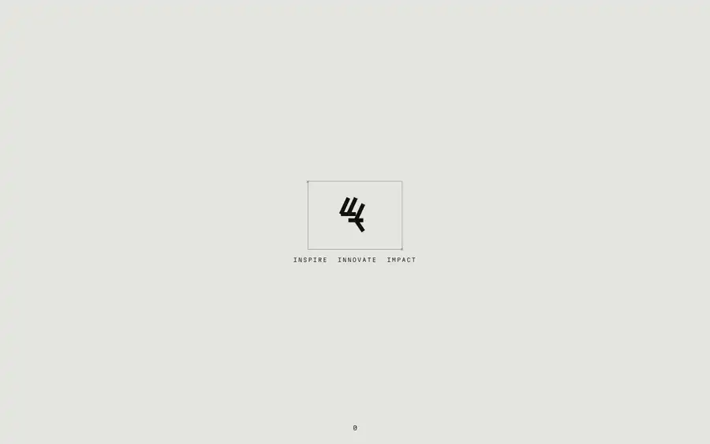

# Agency Motion Study

A motion/interaction study recreating an award-style agency site in vanilla HTML, CSS and JS. Inspired by trionn.com; built for learning, not affiliated.

[](./demo.mp4)

_Click the preview for the full-quality video._

**Stack:** HTML, CSS, vanilla JavaScript (no frameworks, no build step).


## Run locally

```bash
python3 -m http.server 8000
# then open http://localhost:8000
```

Or open `index.html` directly in a browser.
